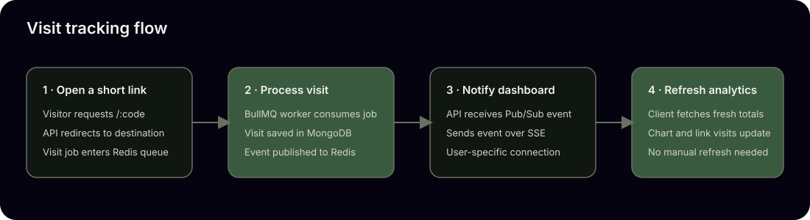
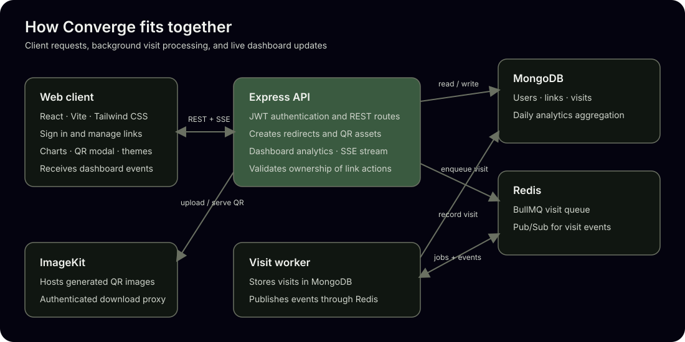

<p align="center">
  
</p>

<h1 align="center">Converge</h1>

<p align="center">
  A full-stack URL shortener with QR codes, visit analytics, and live dashboard updates.
</p>

## Overview

Converge lets people create and manage short links, share their QR codes, and track visits from a single dashboard. The React client talks to an Express API. MongoDB stores accounts, links, and visits; Redis and BullMQ process visit events; ImageKit hosts generated QR images.

## Features

- Register and sign in with JWT-based authentication.
- Create short links and copy them to the clipboard.
- View, delete, and inspect visit counts for saved links.
- Generate QR codes, preview them in a modal, share them, and download them.
- View total link and visit counts, top links, and daily visits for the latest 30 days.
- Receive visit updates in the dashboard through server-sent events (SSE).
- Switch between persistent light and dark themes.

### Product flow



### Architecture



## Technology

| Area | Tools |
| --- | --- |
| Frontend | React 19, Vite 8, Tailwind CSS 4, Recharts, Lucide |
| API | Node.js, Express 5, JWT, Zod |
| Database | MongoDB and Mongoose |
| Background processing | Redis, BullMQ, and a visit worker |
| QR images | `qrcode` and ImageKit |

## Requirements

- Node.js `^20.19.0` or `>=22.12.0` (required by the installed Vite version)
- npm
- MongoDB
- Redis
- An ImageKit account and private key

## Local setup

Install dependencies for all three packages. Root dependencies provide the Tailwind Vite plugin and Recharts used by the client build.

```bash
npm install
npm --prefix server install
npm --prefix client install
```

Create local environment files from the examples:

```bash
cp server/.env.example server/.env
cp client/.env.example client/.env
```

Update `server/.env` with your MongoDB URI, Redis URI, JWT secret, and ImageKit private key. The sample values work only when MongoDB and Redis are running locally. `CLIENT_URL` must match the client origin; `API_BASE_URL` should be the public origin used for short links.

Start MongoDB and Redis, then run the API, worker, and client in separate terminals:

```bash
# Terminal 1: API
cd server
npm run dev
```

```bash
# Terminal 2: visit-processing worker
cd server
npm run worker
```

```bash
# Terminal 3: web client
cd client
npm run dev
```

Vite prints the client URL (usually `http://localhost:5173`). The API defaults to `http://localhost:3000`; `/api/health` can be used to check that it is responding. Keep the worker running to persist visits and deliver live dashboard updates.

## Environment variables

### Server (`server/.env`)

| Variable | Required | Purpose |
| --- | --- | --- |
| `MONGODB_URI` | Yes | MongoDB connection string. |
| `MONGODB_DB` | No | MongoDB database name; defaults to `converge`. |
| `REDIS_URI` | Yes | Redis connection string used by the API, worker, queue, and Pub/Sub. |
| `JWT_SECRET` | Yes | Secret used to sign and verify authentication tokens. Use a long, random value. |
| `IMAGEKIT_PRIVATE_KEY` | Yes | Private ImageKit key used to upload QR images. Keep it server-side. |
| `CLIENT_URL` | Yes | Allowed client origin for CORS, such as `http://localhost:5173`. |
| `PORT` | No | API port; defaults to `3000`. |
| `API_BASE_URL` | No | Public base URL for generated short links; otherwise derived from the request. |

### Client (`client/.env`)

| Variable | Required | Purpose |
| --- | --- | --- |
| `VITE_API_BASE_URL` | No | API origin; defaults to `http://localhost:3000`. |

`VITE_API_BASE_URL` is embedded when Vite builds the client. Set it to the deployed API origin for production builds.

## API routes

Protected routes require `Authorization: Bearer <token>`.

| Method | Path | Authentication | Purpose |
| --- | --- | --- | --- |
| `GET` | `/api/health` | No | API health check. |
| `POST` | `/api/auth/register` | No | Create an account. |
| `POST` | `/api/auth/login` | No | Sign in and receive a token. |
| `GET` | `/api/auth/me` | Yes | Return the signed-in user profile. |
| `GET` | `/api/links` | Yes | List the user’s links and visit counts. |
| `POST` | `/api/links` | Yes | Create a short link. Body: `{ "originalUrl": "https://example.com" }`. |
| `DELETE` | `/api/links/:id` | Yes | Delete an owned link. |
| `GET` | `/api/links/:id/qr/download` | Yes | Download an owned link’s QR image. |
| `GET` | `/api/analytics/dashboard` | Yes | Return summary metrics and daily visit totals. |
| `GET` | `/api/analytics/:id` | Yes | Return analytics for one link. |
| `GET` | `/api/analytics/events` | Yes | Stream user-specific visit events over SSE. |
| `GET` | `/:code` | No | Redirect a short code and enqueue its visit. |

## Build and lint

Run client commands from `client/`:

```bash
npm run build
npm run lint
```

## Visit tracking

Redirect requests enqueue visit jobs in Redis. The worker stores visits in MongoDB and publishes a Redis event. The API forwards that event to the user’s open dashboard over SSE, which then refreshes its link and analytics data.

## Troubleshooting

- **CORS errors:** Make `CLIENT_URL` match the exact URL Vite reports, including the port.
- **API connection errors:** Check that the server is running and `VITE_API_BASE_URL` points to it.
- **Server startup errors:** Confirm MongoDB and Redis are reachable and the required server variables are set.
- **Visits do not update:** Keep `npm run worker` running and check that both API and worker use the same `REDIS_URI`.
- **QR creation fails:** Verify that `IMAGEKIT_PRIVATE_KEY` is valid and the server can reach ImageKit.
